# ⚔️ Game of Thrones: Realm at War

A feature-complete 2D desktop strategy, kingdom builder, and simulation game set in the *Game of Thrones* universe, built with Java and the libGDX game framework.

  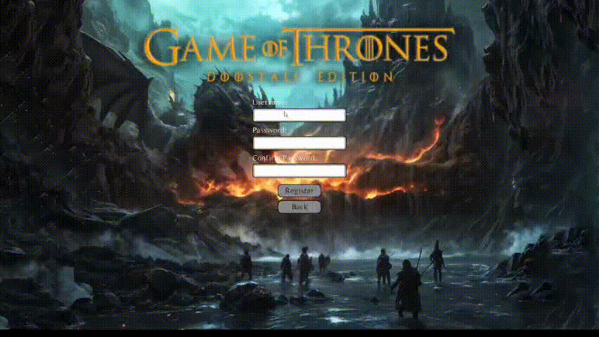

---

## 🌟 Overview

Game of Thrones: Realm at War combines territory development, tactical troop deployment, dynamic seasonal survival, and an in-depth battle system into an engaging desktop experience. Players establish house strongholds across Westeros, manage volatile market economies, defend against devastating White Walker winter waves, and launch strategic sieges against rival lords.

---

## 📸 In-Game Showcase

### 🏰 Kingdom Overview & Seasonal Shifts
The realm undergoes visual and gameplay transformations as seasons rotate. From lush summer production to harsh freezing winters, environmental factors directly impact resource output and combat stats.

| Standard Domain | Fortified Stronghold | Winter Incursion |
| :---: | :---: | :---: |
| 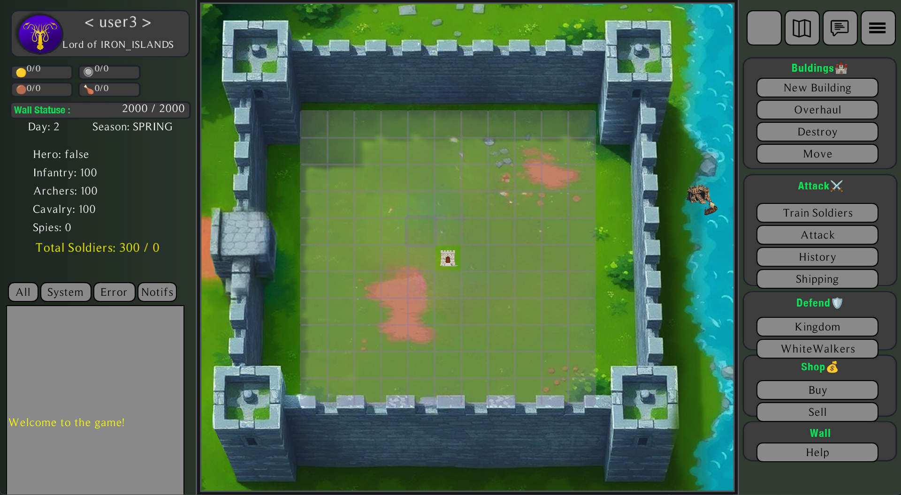 | 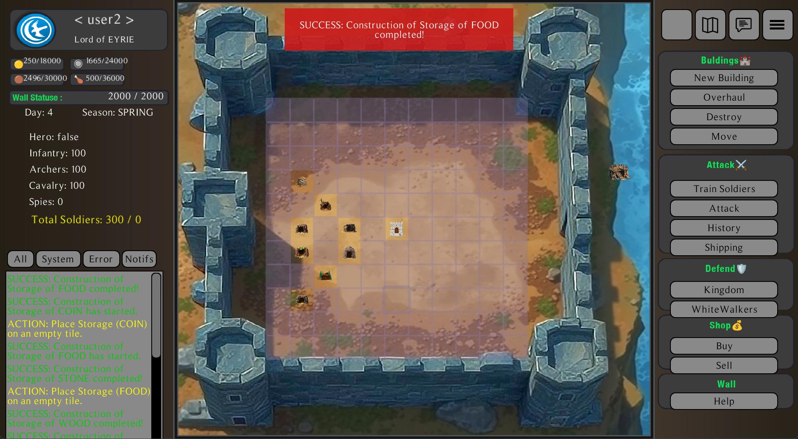 | 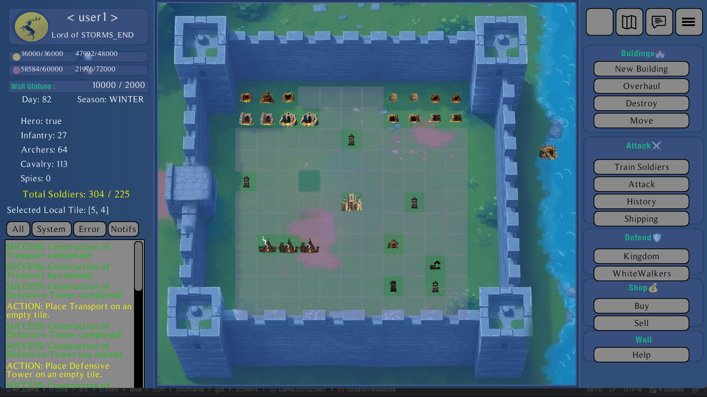 |

---

### 🗺️ World Map & Lobby Deployment
Select target territories across Westeros with calculated marching distances and launch strategic campaigns directly through interactive map panels.

| Known World Map | War Lobby (Host) | War Lobby (Standard) |
| :---: | :---: | :---: |
| 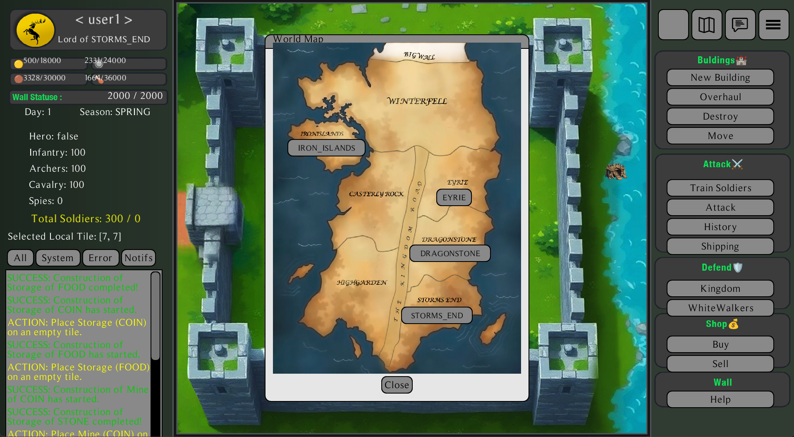 | .png) | 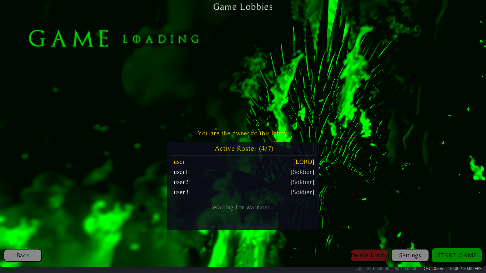 |

---

### 🛡️ City Building, Training & Economy
Build and upgrade specialized resource mines, storages, defensive towers, barracks, and camps. Trade scarce resources on the open market or contract specialized units.

| Construction Ledger | Unit Training Facility | Marketplace (Offers) |
| :---: | :---: | :---: |
| 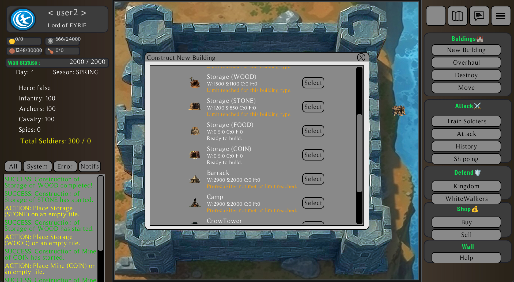 | 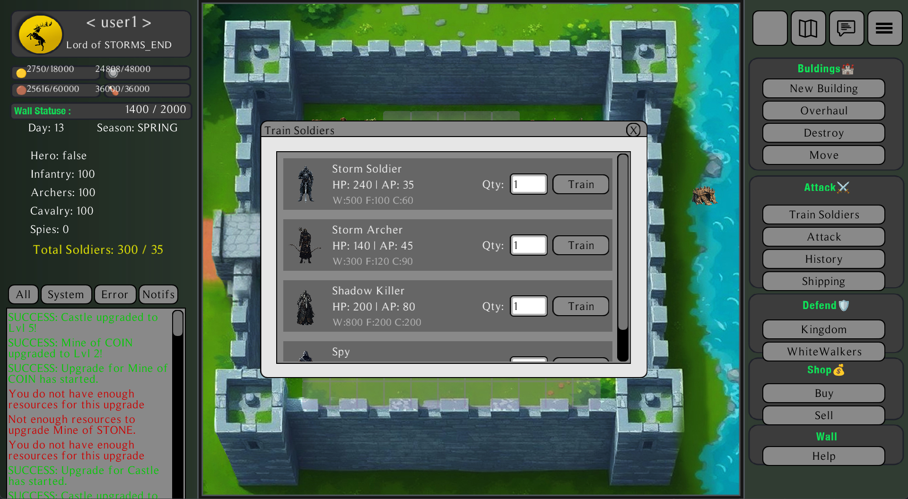 | 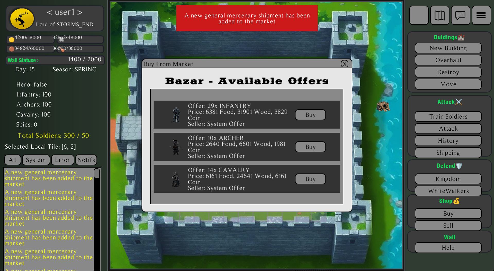 |

---

### ⚔️ Battle Operations, Logging & Replay
Plan multi-phase assaults with custom army formations. Review historical skirmishes through the battle log or watch synchronized round-by-round combat replays with interactive playback controls.

| Siege Preparation | Engagement Log | Replay Playback Engine |
| :---: | :---: | :---: |
| 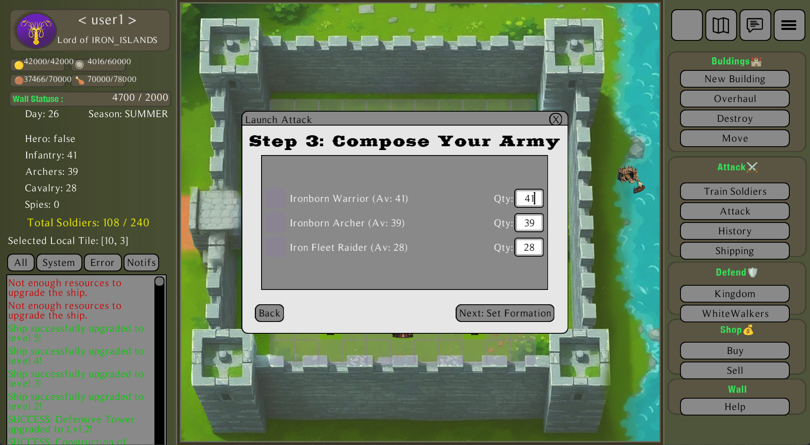 | 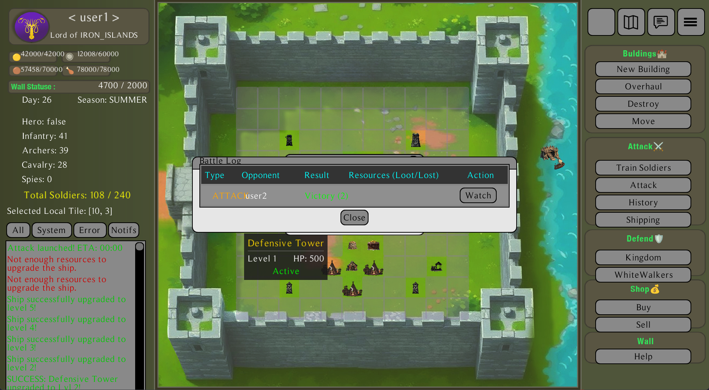 | 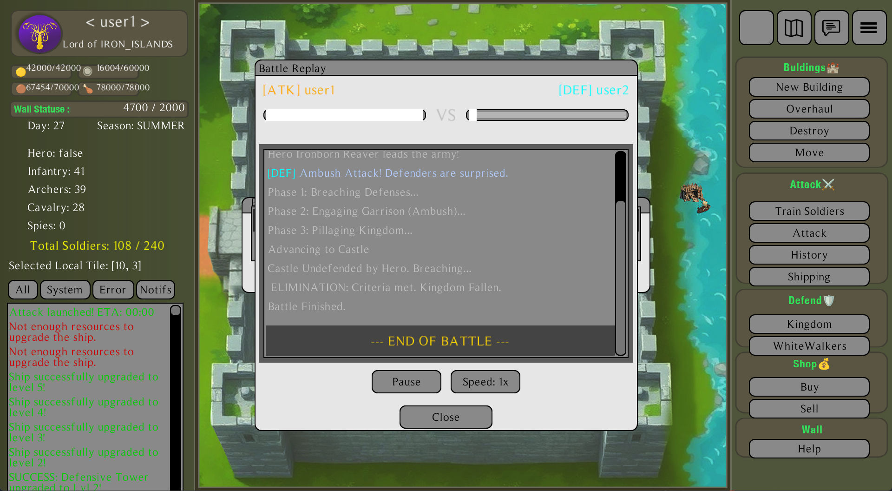 |

---

## 🎮 Key Features

- Territory & Infrastructure Management: Construct, relocate, repair, and upgrade diverse functional structures with real-time timers and resource gates.
- Dynamic Seasonal Engine: Rotating seasons (Spring, Summer, Autumn, Winter) bringing unique gameplay modifications, audio ambiance, and environmental debuffs.
- Military Formations & Combat: Organize Infantry, Archers, Cavalry, and Spies into tactical frontline and support rows. Includes special coastal bombardment mechanics for naval warfare.
- The Long Night & The Wall: A global threat system where White Walkers besiege The Wall. Players can collectively reinforce the fortification using DragonGlass or face kingdom invasions upon catastrophic wall breach.
- Turn-by-Turn Battle Replay: Battles are serialized into discrete chronological events, allowing full visual playback with health tracking and combat event inspection.
- Asynchronous Courier System: Send ravens to neighboring keeps via the Crow Tower for trade diplomacy, player communications, and realm-wide decrees.

---

## 🏛️ Architecture & Engineering Highlights
- Framework & Core: libGDX 1.13.1 on top of LWJGL3 desktop backend.
- Modular Project Structure:
    - core: Pure game domain logic, algorithms, custom data structures, and screen controllers.
    - lwjgl3: Desktop runtime launcher, windowing configurations, and native asset bridges.
    - headless: Non-graphical build target suitable for automated simulation tests.
- Design Patterns Applied:
    - Mediator Pattern: Decouples complex UI event handling and Screen controllers from underlying game domain data models via GameMediator.
    - State Pattern: Encapsulates building states (underConstruction, upgrading, underRepair, stable, destroyed).
    - Factory Pattern: Dynamic troop, mercenary, and hero instantiation across distinct Great Houses.
- Data Persistence: Custom file serialization (.ser) paired with transaction logs for robust offline state saving and loading.

---

## 🚀 Getting Started

### Prerequisites
- Java Development Kit (JDK): Version 17 or newer
- Gradle: 8.5+ (Wrapper provided)

### Running from Source
Clone the repository and run using the Gradle wrapper:

`bash
# Clone the repository
git clone [https://github.com/mmatvakili-lgtm/GOT.git](https://github.com/mmatvakili-lgtm/GOT.git)

cd GOT

# Run the desktop application (Windows)
.\gradlew.bat lwjgl3:run

# Run the desktop application (Linux / macOS)
./gradlew lwjgl3:run

# Building Standalone Executable (JAR)
.\gradlew.bat lwjgl3:jar

The compiled fat-JAR will be generated in lwjgl3/build/libs/AP-Game.jar.

# 📜 License
Developed as an academic software engineering and project-based programming portfolio project at the University of Kashan.
